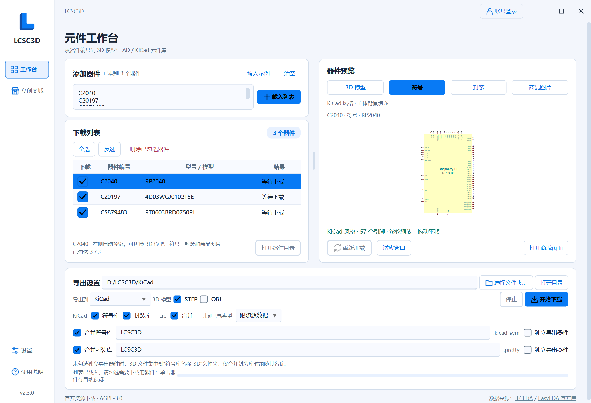
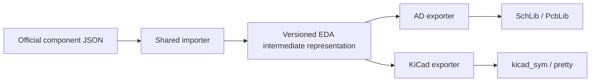

<p align="center">
  <picture>
    <source media="(prefers-color-scheme: dark)" srcset="app/assets/branding/lcsc3d-logo-dark.svg">
    
  </picture>
</p>

[简体中文](README.md) | **English**

# LCSC3D: LCSC 3D Model Downloader and AD / KiCad Library Exporter

[](https://github.com/Travelerrrrrr/LCSC3D/releases/latest)
[](https://github.com/Travelerrrrrr/LCSC3D/actions/workflows/windows.yml)
[](https://github.com/Travelerrrrrr/LCSC3D/releases/latest)
[](LICENSE)
[](docs/sponsorship.md)

**Find parts through LCSC search, mainland account favorites or C-numbers, preview official resources, download STEP / OBJ models, and export AD or KiCad symbol and footprint libraries in batches.**

LCSC3D is a portable Windows tool for hardware development, PCB design and mechanical fit checks. Download and run `LCSC3D.exe`; no Python installation is required. Generating libraries does not require the target EDA software to be installed.

**Current version: 2.3.0** · **[Download for Windows](https://github.com/Travelerrrrrr/LCSC3D/releases/latest/download/LCSC3D.exe)** · [Full source package](https://github.com/Travelerrrrrr/LCSC3D/releases/latest/download/LCSC3D.zip) · [User guide (Chinese)](app/README.md) · [Release notes (Chinese)](docs/releases/v2.3.0.md) · [Report an issue](https://github.com/Travelerrrrrr/LCSC3D/issues)



## What's new in 2.3.0

- **KiCad 8+ export:** Generate `.kicad_sym` symbol libraries and `.pretty` footprint libraries, with individual exports, independent merging and optional per-part copies.
- **Target-specific settings:** Switch between AD and KiCad through **Export to**, retaining each target's settings. Configure KiCad pin electrical types and preview symbols in KiCad style.
- **EDA intermediate representation:** Store component electrical and geometric information once, then generate files through each EDA's exporter, providing a foundation for future targets.
- **Export and layout fixes:** Correct reversed pins in some symbols, support footprint vias, and fix overlapping result text, control spacing and flicker when toggling Merge.
- **Selection and file management:** Product thumbnails in search and favorites, 20 results per search page, and custom AD project output folders, library names and direct library imports. Improved export logging and diagnostics.

Earlier changes are listed in the [version history (Chinese)](docs/版本历史.md).

## Quick start

1. Download `LCSC3D.exe` from [Releases](https://github.com/Travelerrrrrr/LCSC3D/releases/latest) and run it on Windows 10/11 x64.
2. For English, open **设置 → 外观 → 语言 / Language**, select **English**, and click **保存 / Save**. Search through **LCSC International** and add checked products to the download list, or enter `C2040, C20197, C456013` and click **Load list**.
3. Click a part to preview it, check the parts to export, and choose an output folder.
4. Choose **Altium Designer / KiCad** under **Export to** and select model and library formats. Enable **Lib → Merge** to combine libraries and set their names independently.
5. Click **Download**, then **Part folder**. Open SchLib / PcbLib in AD, or add the symbol file and footprint directory through KiCad's library managers.

**Merging again uses the current selection.** Normal and merged AD / KiCad exports replace same-name libraries after successful generation. KiCad replaces the entire same-name `.pretty` directory, removing old members. Include every part you want to retain. AD's **Append** mode adds parts to existing libraries; KiCad append is not currently available.

## Symbol and footprint export

| Feature | Altium Designer | KiCad 8+ |
| --- | --- | --- |
| Formats | Native `.SchLib` / `.PcbLib` | `.kicad_sym` / `.kicad_mod` files in `.pretty` |
| Individual and merged libraries | Independent symbol/footprint merging and names, optional per-part copies | Same workflow, with shared-footprint reuse |
| Pin electrical types | All exported pins are Passive | Source types by default or a uniform override; unsupported types become Unspecified |
| Symbol style | JLC / AD, selected in the preview and applied to export | KiCad style; square rectangles with solid body-background fill |
| Footprint geometry | Pads, holes, slots, copper regions, graphics and native vias | Pads, holes, slots, copper regions and graphics; vias retained as unnumbered plated through-holes |
| Append and projects | Append to libraries, customize project folders/names and import into `.PrjPcb` | Append and automatic project registration are not yet supported |

In KiCad, **use the exported footprint library name as its nickname**, such as `LCSC3D`, so symbol footprint references resolve. Footprint vias retain their positions, drills and copper rings; confirm their net assignment in the PCB. Conversion approximations appear in export results.

Both targets support multi-unit symbols, string pin numbers and common surface-mount / through-hole footprints. **Neither currently binds 3D models automatically.** Download STEP files, add them in your EDA, and check position, height and rotation. AD IntLib generation is not supported.

Detailed operations are in the [user guide (Chinese)](app/README.md).

## Intermediate representation and exporters



The intermediate representation stores symbols and units, pin names and numbers, connection directions and electrical types, graphics, text, layers, pads, drills, slots, vias and source 3D associations. AD and KiCad exporters read the same data and generate libraries according to each target's format and settings.

It has independent versioning and compatibility rules: new optional fields have defaults, existing fields retain their meaning, and older data remains readable. Critical geometry that cannot be converted reliably produces an explicit error. Future EDA support can reuse the importer and component data while adding an exporter for the target's styling and library rules.

See the [architecture and compatibility guide (Chinese)](docs/EDA中间层.md) for details.

## Selection, previews and batch downloads

| Feature | What it provides |
| --- | --- |
| Store and favorites | Search by C-number, MPN or keyword, with 20 results per page and selections retained across pages. Search and favorites show thumbnails; double-click to view original images. |
| Prices and information | View stock, choose price tiers independently, read full specifications, and open datasheets and original images. |
| Four previews | Switch between 3D models, symbols, footprints and product photos, with zoom, pan and fit-to-window controls. |
| Batch downloads | Combine STEP / OBJ with the selected target's two library formats; track per-part results, stop and retry. |
| Library organization | Reuse identical footprints and optionally retain individual parts. Without per-part copies, models use a shared `library-name_3D` folder. |

Parts without 3D models may still have exportable symbols and footprints. One format failing does not discard other successful resources. Availability depends on the official data and task results.

## Settings, diagnostics and updates

**Settings** provides Simplified Chinese / English, system / light / dark themes, colors, button text colors, fonts and 10–24px text sizes. English uses LCSC International with English descriptions and USD prices. International sign-in and favorites are managed on LCSC.com; mainland and international account sessions are separate.

Storefront and update requests can independently use the system proxy or direct connections. **Diagnostics** lets you choose log levels, open, package or clear logs. Logs cover downloads, AD / KiCad conversion, file replacement and recovery. Diagnostic packages exclude credentials, and logging and crash capture continue after clearing. AD append and project changes support automatic backups, available under **Settings → Backups**.

Settings, sessions, logs, caches and update data live under `%LOCALAPPDATA%/LCSC3D/`. Model and library output folders are chosen separately.

Startup checks for stable updates in the background. Use **Settings → About & support → Check for updates** for a manual check. **Download & restart** installs an update after SHA-256 verification, retaining settings and exported files. Releases include `LCSC3D.exe`, full source in `LCSC3D.zip`, and `SHA256SUMS.txt`.

## Requirements and limitations

Downloads and online previews need internet access. 3D preview needs a graphics driver supporting WebGL. KiCad 8 / 9 / 10 have been verified; see the [verification record (Chinese)](docs/2.3.0验证记录.md) for scope.

Preview and export assist selection and design. Check pins, electrical types, dimensions and footprints against the datasheet before production use. Re-export any symbols affected by reversed pins in earlier versions.

## Run from source and build

Development environment: Windows x64 and Python 3.12.

```powershell
git clone https://github.com/Travelerrrrrr/LCSC3D.git
cd LCSC3D
python -m venv .venv
.\.venv\Scripts\python.exe -m pip install -r app/requirements-test.txt
.\.venv\Scripts\python.exe app/main.py
```

Run `app/build.ps1` to test and build the portable application. See the [contribution guide (Chinese)](CONTRIBUTING.md) for development and release procedures.

## License, data sources and support

Project code uses [AGPL-3.0-or-later](LICENSE); dependency attribution is in the [third-party notices](app/licenses/THIRD-PARTY.md). Symbols, footprints and models come from the [JLCEDA Official Library](https://lceda.cn/) and the [EasyEDA Official Library](https://easyeda.com/). The software license does not replace the component data's copyright or usage terms.

Report problems through [Issues](https://github.com/Travelerrrrrr/LCSC3D/issues), including the C-number, version, selected formats, error and screenshots. Stars and [voluntary sponsorship](docs/sponsorship.md) are welcome.

## Acknowledgments

Thanks to [uPesy/easyeda2kicad.py](https://github.com/uPesy/easyeda2kicad.py) for ideas and reference material on converting EasyEDA / LCSC components to KiCad.
