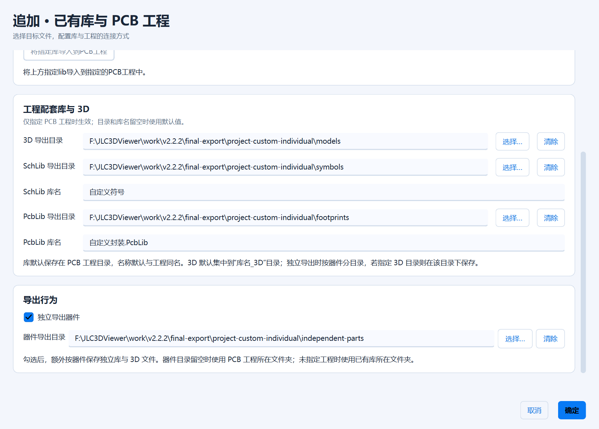

<p align="center">
  <picture>
    <source media="(prefers-color-scheme: dark)" srcset="app/assets/branding/lcsc3d-logo-dark.svg">
    
  </picture>
</p>

[简体中文](README.md) | **English**

# LCSC3D: LCSC 3D Model Downloader and Altium Designer Library Exporter

[](https://github.com/Travelerrrrrr/LCSC3D/releases/latest)
[](https://github.com/Travelerrrrrr/LCSC3D/actions/workflows/windows.yml)
[](https://github.com/Travelerrrrrr/LCSC3D/releases/latest)
[](LICENSE)
[](docs/sponsorship.md)

**Find LCSC parts, inspect prices, stock and product details, download official STEP / OBJ models, and export native Altium Designer libraries in batches.**

LCSC3D is a portable Windows tool for hardware development, PCB design and mechanical fit checks. It combines storefront search, mainland account favorites, model downloads, Altium Designer library export and four preview modes in one application. Download and run `LCSC3D.exe`; no Python installation is required. Exporting AD libraries does not require Altium Designer to be installed either.

**Current development version: 2.2.2** · **[Download the published Windows version](https://github.com/Travelerrrrrr/LCSC3D/releases/latest/download/LCSC3D.exe)** · [Full source package](https://github.com/Travelerrrrrr/LCSC3D/releases/latest/download/LCSC3D.zip) · [Release notes (Chinese)](docs/releases/v2.2.2.md) · [Report an issue](https://github.com/Travelerrrrrr/LCSC3D/issues)

**Custom append destinations, library names and direct project import.** Version 2.2.2 supports separate 3D, SchLib and PcbLib folders for project exports, a separate part folder, and a direct library-import button in Append settings. The latest local build is `outputs/LCSC3D.exe`; download links still point to the published version.


Screenshots show the actual application, using 2.2.1 except for the updated Append settings. Most are in Simplified Chinese; English settings and international-store screenshots are included below. Product prices and availability may change after the screenshots were taken.

## What's new in 2.2.2

| Update | What it provides |
| --- | --- |
| **Project output folders and names** | With only a PCB project selected, configure separate 3D, SchLib and PcbLib folders and both library names. Blank values use defaults; existing libraries are appended. |
| **Separate part folder** | Choose a folder for individual exports. When blank, it defaults to the PCB project folder, or the existing library folder if no project is selected. |
| **Direct project import** | Click **Import specified libraries into PCB project** below the target files in Append settings. Requires both a library and a project; no downloads are needed. |
| **File picker improvements** | Toolbar icons remain visible across themes and font sizes. Separate Material cards and a draggable divider distinguish places from the file list. |

Library merging, appending, PCB project integration, reuse of identical footprints and separate part exports remain available. Earlier changes are listed in the [version history (Chinese)](docs/版本历史.md).

## Quick start

1. Download `LCSC3D.exe` from [Releases](https://github.com/Travelerrrrrr/LCSC3D/releases/latest) and run it on Windows 10/11 x64.
2. To use English, open **Settings → Appearance**, select **English** under **Language**, then click **Save**. On the default Chinese interface, these controls are labeled **设置 → 外观 → 语言 / Language → English → 保存**.
3. Open **LCSC International**, search by C-number, manufacturer part number (MPN) or keyword, check the parts you need, and click **Add to download list**. Alternatively, enter `C2040, C20197, C456013` in the workspace and click **Load list**.
4. Click a row to preview the part. Check the rows to export, choose an output folder and any combination of `STEP`, `OBJ`, `SchLib` and `PcbLib`, then click **Download**.
5. Click **Part folder** to open the exported files. Open or install SchLib / PcbLib files in Altium Designer, or use STEP / OBJ files with compatible CAD and 3D tools.

**International accounts:** English mode searches and imports products inside the application. International sign-in and account favorites are managed on the LCSC.com website through the provided links. In-app sign-in and favorites import are available for the mainland storefront in Simplified Chinese mode; the two sites do not share saved sessions.

## Features

| Feature | Capabilities |
| --- | --- |
| Store search | Search by C-number, MPN or keyword, with up to 20 results per page and selections retained across pages. International keyword searches also provide a category selector when applicable. |
| Prices and stock | View available stock and independently select each product's quantity-price tier. Mainland prices use CNY; international prices use USD. |
| Mainland account favorites | Sign in, retrieve account favorites, save a product as a favorite or remove it, and import checked favorites into the download list. |
| Product information and images | Read full descriptions and parameters, open datasheets, and view original product images with zoom and pan. |
| Batch part lookup | Enter multiple C-numbers, look up their MPNs automatically, remove duplicate numbers and see results for each part. |
| STEP / OBJ downloads | Save official 3D models for mechanical assembly, clearance checks and other 3D workflows. |
| AD schematic libraries | Generate native `.SchLib` files with pin names, numbers, Passive electrical types and multi-unit symbols. |
| AD footprint libraries | Generate native `.PcbLib` files with pads, holes, slots, copper regions and footprint graphics. |
| Four preview modes | Switch between 3D models, schematic symbols, PCB footprints and product photos before exporting. |
| Libraries and PCB projects | Merge libraries, append to existing libraries and add library references to a `.PrjPcb` project. Optionally keep separate exports for each part. |
| Queue management | Check parts, select all, invert the selection or remove checked rows, and freely combine the four output formats. |
| Task and file management | Track overall progress and per-part results, stop a task, open part folders and fetch selected resources again. |
| Portable operation and updates | Run a single EXE, remember export preferences, and download updates with checksum verification and restart. |
| Settings and diagnostics | Configure storefront and update proxies independently, select a log level, and open, package or clear logs. |
| Backups and restoration | Control automatic backups, inspect disk usage, restore older files and clear backups after confirmation. |

## Appearance and language

Open **Settings → Appearance**. Changes are previewed in Settings; click **Save** to apply and remember them, or **Cancel** to retain the previous settings.

- **Language:** Choose Simplified Chinese or English without restarting. English mode uses [LCSC International](https://www.lcsc.com/) for English product details, USD prices, stock and original images. Product-page links follow the selected language; the download queue and checked parts are retained.
- **Appearance:** Light is the default. Choose **Follow system**, **Light** or **Dark**. Follow system also responds to system appearance changes while the application is running.
- **Accent color:** The default brand blue is `#087AF5`. Choose teal, blue, purple, rose, orange or a custom color. Buttons, selections, progress bars and highlighted text follow the accent.
- **Button text color:** Choose **Auto**, **White**, **Black** or **Choose text color…**. A manual color is retained when changing the accent or appearance. Auto selects black or white according to contrast.
- **Interface font:** Choose an installed font and preview it, or use **Reset to default**. If a saved font is unavailable on another computer, the application falls back to an available default.
- **Font size:** Set 10–24px; the default is 13px. Enter a value or use the minus/plus controls. Titles, hints and list row heights adjust with it; content can scroll at larger sizes.

For white text on teal buttons, choose a teal accent and set **Button text color → White**, then save. Official symbol and footprint previews retain their original graphics, colors and text sizes.


## Store search, prices and product details

Open the store and enter a C-number, MPN or keyword. Search does not require sign-in. Click a row to read product details, or **Preview selected** to return to the workspace and preview that part. Returning to the store retains the current page and selections.

Each page contains up to **20 parts**. Every row includes a photo thumbnail between its checkbox and C-number; double-click the photo to open the original gallery. Photos keep their proportions, load asynchronously and are cached for page navigation. Missing or failed photos use a placeholder. Narrow tables scroll horizontally while keeping model names readable.

Previous/next page controls fetch only the requested page. Checkboxes select parts to import, while the highlighted row controls the detail view and preview. New search results and mainland favorites start unchecked. **Add to download list** imports checked parts across the pages of the current search; select-all and invert operate on the current page. A new search clears the previous search's selections and price-tier choices.

Price tiers are independent for each product. The mainland storefront defaults to **1+**, or the lowest available minimum-order tier when 1+ is unavailable, retaining the original price precision. Returning to a page restores its manually selected tiers. Stock shows available quantity, `0` means no stock, and `—` indicates missing price or stock information. English mode displays the international storefront's USD prices and stock.

Descriptions and parameters wrap and scroll so that long details can be read. Use **Datasheet** and **Product page** to open the official links.


### Original product images

Click a product image or the view-all-images control to open the gallery within the application. Use thumbnails, previous/next controls or the arrow keys to switch images. Scroll or use the zoom buttons to zoom, drag to pan, and choose original size or **Fit**. Double-clicking also restores the view.


## Mainland sign-in and account favorites

This section applies to the mainland storefront in **Simplified Chinese mode**. In English mode, international sign-in and favorites links open LCSC.com; international favorites are managed on that website.

The account control at the top right shares sign-in status across pages. Mainland in-app sign-in supports **WeChat QR code**, **account/password** and **SMS code**. Image verification, when required by the server, is completed in the same interface and supports refreshing the image. Sending an SMS code starts a 60-second retry countdown.

| Account/password sign-in | SMS sign-in |
| --- | --- |
| <a href="docs/images/2.2.1-release/login-password.png"></a> | <a href="docs/images/2.2.1-release/login-sms.png"></a> |

**Remember sign-in** is enabled by default. A valid saved session is restored after restarting. Only session data is saved, encrypted with Windows DPAPI for the current Windows user; account passwords are not saved. Signing out clears the application's current and saved session. International requests do not read or send the mainland session.

After mainland sign-in, open the account-favorites page and refresh the list as needed. Check parts and add them to the download list. Search products can be saved as favorites, and existing favorites can be removed. Removing an account favorite or a queue row leaves downloaded files intact.

Import deduplicates by C-number and retains existing checked states and download results. Newly imported parts are checked in the workspace. Favorites can be filtered after retrieval; favorites selection and import apply to the visible filtered items. Wait for an active download to finish before changing the queue.

## Native Altium Designer libraries

### Schematic libraries: SchLib

Select `SchLib` to generate a native AD schematic library from official structural component data. Exports retain pin names, actual pin numbers, orientation and visibility, as well as text, outlines and source parameters. All exported pins use the Passive electrical type in both appearance styles. Alphabetic and combined pin numbers and multi-unit symbols are supported.

Multi-unit components are exported using each unit's origin and pin assignment. The symbol's PCB model reference matches the footprint name in the corresponding footprint library.

### Footprint libraries: PcbLib

Select `PcbLib` to generate a native AD PCB footprint library. Supported geometry includes common surface-mount and through-hole pads, rectangular/circular/oval pads, and polygonal, custom or concave pads with valid outlines in the source data. Hole diameter, slot length, rotation, copper-to-hole offset, plating status and solder-mask/paste expansion are retained.

Unsupported primitives or multi-contour regions cause the affected export to report a failure. Other successfully downloaded or generated resources in the same task are kept. A part without a linked 3D model may still have a usable schematic symbol and footprint.

Open or install the generated files in Altium Designer. **IntLib output is not currently supported.**

### Adding a STEP model to PcbLib

**Exported PcbLib files do not currently embed or bind 3D models.** To display a 3D body in AD, also download `STEP`, add a **3D Body** in the PcbLib editor and import the STEP file. Check **XYZ position, height and rotation** against the pads and the part's mounting position, and adjust offsets and angles as needed.

Official standalone models may use an origin, axis orientation or placement different from the AD footprint coordinates. The exporter does not yet convert the official 3D association and placement data into AD 3D Body parameters, so an imported model may require alignment.

Automatic embedding and improved placement handling are planned for a future version.

## Four preview modes

Load the list to preview the first part automatically, then click another row to switch parts. Previewing does not require saving files first.

| Preview | Resource and use | Controls |
| --- | --- | --- |
| **3D model** | Locally render the official OBJ model. STEP / OBJ downloads preserve the official files; STEP is suitable for CAD tools such as SolidWorks and FreeCAD. | Left-drag to rotate, scroll to zoom, right-drag to pan. |
| **Symbol** | Show official schematic graphics, pin names and numbers. Multi-unit components provide a unit selector. | Scroll to zoom, left-drag to pan. |
| **Footprint** | Show pads, holes, outlines, numbering and official layer colors. | Scroll to zoom, left-drag to pan. |
| **Photos** | Show original storefront product images, with previous/next controls for multiple images. | Scroll to zoom, drag to pan. |

All four modes support **Fit** and double-click to restore the view. If loading fails, use **Reload** or open the product page. The initial 3D view keeps the part's top facing up. Preview controls remain usable while download progress updates.

| Schematic symbol preview | PCB footprint preview |
| --- | --- |
| <a href="docs/images/2.2.1-release/symbol.png"></a> | <a href="docs/images/2.2.1-release/footprint.png"></a> |


<details>
<summary>Compare previews with the official storefront resources</summary>

The same C456013 part is shown on the official storefront below. Symbol and footprint previews use the official graphics, and the 3D preview reads the official model.


</details>

## Merge, append and PCB project integration

The **Symbol** preview tab includes **Symbol style: JLC / AD**. Changing the style updates the preview and new SchLib exports. AD uses dark red outlines, black pins and dark blue Times New Roman text while retaining each original text size (SchLib font sizes retain the existing integer-point rounding). Native rectangles use a Small border with both Fill Color and Transparent enabled, regardless of the original fill. Pins shorter than 200 mil extend outward with their body ends fixed; longer pins stay unchanged. JLC retains the original appearance and pin lengths. Both styles export every pin as Passive. Canvas backgrounds remain white. The selection is saved, and existing library entries retain their content when appending.

The compact input area and table header leave more room for the download list, with a wider scrollbar and pixel scrolling. Batch progress and status appear inside the export control panel below. Text on selected rows follows the configured button text color with or without keyboard focus.

**Lib → Merge** and **Lib → Append** are mutually exclusive. Each mode exposes its configuration controls.

- **Merge:** Enable SchLib and/or PcbLib merging and set library names. Successfully converted parts are saved into merged libraries at the output-folder root. Existing files with the same names are replaced only after successful generation. Separate per-part exports can also be retained.
- **Append:** Choose an existing SchLib, PcbLib or both. Only the corresponding selected formats are appended. Configure destinations in Append settings; the ordinary output-folder control is disabled.
- **Footprint reuse:** Identical footprints reuse an entry. Different footprints with the same name receive numeric suffixes, and symbol references are updated to match.
- **PCB project:** Specify existing libraries and a `.PrjPcb` file, then click **Import specified libraries into PCB project** in Append settings. It imports the current selections immediately, regardless of whether the download queue is empty. Duplicate references are skipped. The old saved checkbox no longer triggers automatic imports.
- **Project-only destination:** Choose separate folders for 3D models, SchLib and PcbLib, and customize both library names. Blank library folders and names default to the project folder and name. Generated libraries are added to the project; existing libraries are appended.
- **Export each part:** Also save individual libraries and models in a configurable part folder. A blank folder defaults to the project folder, or the existing library folder without a project. An explicit 3D folder takes precedence for models and uses part subfolders when this option is enabled. Without separate exports or an explicit 3D folder, models use a `library-name_3D` folder beside the primary library.

Existing libraries and projects are backed up before modification by default. Manage the automatic-backup setting and restore files in **Settings → Backups**. More detailed instructions are available in the [user guide (Chinese)](app/README.md#追加已有库与-pcb-工程).



## Batch downloads and file management

- **Flexible input:** Separate C-numbers with newlines, spaces, commas or semicolons. Chinese punctuation is also accepted. C-numbers are case-insensitive and duplicates are removed.
- **Lookup and selection:** Loading the list queries MPNs in the background. Downloads process only checked parts. **Select all**, **Invert** and the highlighted preview row control selection and viewing independently.
- **Remove checked:** Remove checked parts from the queue and input field while retaining other results and downloaded files. Removal is disabled during a download.
- **Choose formats:** Combine `STEP`, `OBJ`, `SchLib` and `PcbLib` freely, including exporting only AD libraries.
- **Per-part results:** See successful, partial, no-model or failed results. One format failing does not discard other successful resources.
- **Refresh existing files:** Each download fetches the selected resources again. Same-name files are replaced only after successful fetching or generation; failures and cancellation retain the original files.
- **Stop and retry:** Stopping keeps completed files. Cancellation takes effect after the current network read finishes. Select the relevant parts again to retry or update them.
- **Remember preferences:** The output folder and format selections are saved. Open part folders and product pages directly from the application.

Ordinary exports use separate **`MPN_C-number`** folders. Individual AD library files are named after the MPN; library entries do not automatically gain a C-number suffix. STEP / OBJ filenames retain the part number and model name. Characters forbidden in Windows filenames are replaced with underscores.

For example, the `RP2040_C2040` folder may contain:

| File | Contents |
| --- | --- |
| `RP2040.SchLib` | Schematic symbol library. |
| `RP2040.PcbLib` | PCB footprint library. |
| `C2040_LQFN-56_L7.0-W7.0-P0.4-EP.step` | Official STEP model. |
| `C2040_LQFN-56_L7.0-W7.0-P0.4-EP.obj` | Official OBJ model. |

Merged or appended exports without **Export each part** place models in the shared `library-name_3D` folder described above.

## Viewing exports in Altium Designer

These user-provided screenshots show exported schematic and footprint libraries opened in **Altium Designer**, along with library references in a `.PrjPcb` project. Appending preserves the original names of existing entries.

| Schematic library in AD | Footprint library in AD |
| --- | --- |
| <a href="docs/images/2.2.0/ad-symbol-user.png"></a> | <a href="docs/images/2.2.0/ad-footprint-user.png"></a> |

<a href="docs/images/2.2.0/ad-project-user.png"></a>

<details>
<summary>More AD examples: multi-unit symbols, BGA footprints and manually added STEP models</summary>

The 3D views below show the result **after manually adding a STEP model in AD**. Exported PcbLib files do not include these 3D bodies automatically.

| Multi-unit schematic symbol | BGA footprint |
| --- | --- |
| <a href="docs/images/screenshots/4.png"></a> | <a href="docs/images/screenshots/5.png"></a> |

| Pads and copper regions | Custom pad geometry |
| --- | --- |
| <a href="docs/images/screenshots/6.png"></a> | <a href="docs/images/screenshots/7.png"></a> |

| Connector footprint | 3D view after importing STEP |
| --- | --- |
| <a href="docs/images/screenshots/8.png"></a> | <a href="docs/images/screenshots/9.png"></a> |

| Type-C 3D view | Type-C underside |
| --- | --- |
| <a href="docs/images/screenshots/12.png"></a> | <a href="docs/images/screenshots/13.png"></a> |

</details>

## Network settings and diagnostics

**Settings → Network** provides independent proxy choices for the **storefront** and **update checks**. Both default to **Use system proxy**. Storefront settings cover search, mainland sign-in, favorites, images and component resources; update settings cover version checks, checksum files and update downloads.

System-proxy mode uses HTTP/HTTPS proxy environment variables first, then the current Windows user's manual system proxy when no environment proxy is set, respecting bypass rules. **Direct connection** ignores those application-level proxies. It does not disable VPN/TUN routing or control pages opened in an external browser. Saved changes apply to new requests and retain the current sign-in session.

**Settings → Diagnostics** supports **Debug, Info, Warning, Error and Critical**, with **Debug** as the default. **Open logs** opens the log folder. Logs cover storefront operations, sign-in, downloads, AD export, previews and updates, with operation identifiers, part/format details, error codes, cause chains and code locations. Credentials are excluded and log rotation limits disk usage.

**Package logs** creates a ZIP in `%LOCALAPPDATA%/LCSC3D/diagnostics/` and opens that folder. It includes application, update-helper, rotated and crash logs plus selected diagnostic information such as software/system versions, effective proxy modes and log level. It does not collect saved sessions or account passwords. When reporting a problem, attach the ZIP together with the time, steps, C-number, selected formats and screenshots.

**Clear logs** asks for confirmation and clears the current and historical logs; logging continues afterward. Previously packaged ZIPs are retained. See the [diagnostics guide (Chinese)](docs/日志排查.md) for details.

## Backups and restoration

Open **Settings → Backups** to view the backup count, disk usage, filenames, original paths and timestamps. Managed library/project backups are stored in `%LOCALAPPDATA%/LCSC3D/backups/`.

**Automatic backups** is enabled by default. Change the switch and save Settings to control backups made before modifying existing SchLib, PcbLib and PCB project files. Disabling it does not remove existing backups.

Select a backup and click **Restore selected**. Review or choose the target path, then confirm restoration. Before overwriting an existing target, its current content is preserved **even when automatic backups are disabled**. Older backups without original-path metadata require a manually selected destination. Invalid backups or a target changed after confirmation are rejected instead of silently overwritten.

**Clear backups** deletes the listed backups after confirmation. Original libraries and projects remain intact. Restoration and cleanup are unavailable during an export task. See the [backup guide (Chinese)](app/README.md#备份与恢复) for more details.


## Portable operation and self-update

The application is delivered as one `LCSC3D.exe`, with its runtime bundled. Application-managed settings, sessions, logs, caches, temporary files and update data live under **`%LOCALAPPDATA%/LCSC3D/`**. Settings are saved in `LCSC3D-settings.json`, rather than beside the EXE. Older settings migrate automatically. The default export location is the `downloads/` subfolder; you can choose another output folder.

At startup, the application checks this repository's latest stable release once in the background. A newer version produces an update notification. No-update and connection-failure cases stay silent; failures are logged. No update is downloaded or installed automatically. For a manual check, use **Settings → About & support → Check for updates**.

The portable EXE supports **Download & restart**. The download is verified against the release's SHA-256 checksum before replacement. The update helper waits for the application to exit, backs up the EXE, replaces it and starts the new version. If replacement or startup fails, the original program is restored. Settings and exported resources are retained.

The EXE folder must be writable for self-update. You can check for updates during a download, but must wait for that task to finish before installing an update. Running from source supports version checks and release-page links rather than automatic source replacement.

Each stable release provides:

| File | Contents |
| --- | --- |
| `LCSC3D.exe` | Portable Windows x64 application. |
| `LCSC3D.zip` | Full application source, build scripts, documentation and licenses. |
| `SHA256SUMS.txt` | SHA-256 checksums for the EXE and source package. |

## Requirements, limitations and validation

- **Platform:** Windows 10/11 x64. Downloads and previews require internet access; 3D preview requires a graphics driver that supports WebGL.
- **Official resources:** Component and SVG requests prefer the official mainland APIs and fall back to the official mirror when needed. Batch downloads reuse connections and use controlled concurrency.
- **Availability:** Some parts have no linked 3D model, and some formats may be unavailable. Symbols and footprints may still be exported where the official data supports them.
- **AD export limits:** Unsupported geometry is reported as an export failure. IntLib generation and automatic embedding/binding of 3D models in PcbLib are not currently supported.
- **Design checks:** Preview and export aid part selection and inspection. Verify pins, dimensions and footprints against the part's datasheet before using them in production designs.

Version **2.2.2 passed 456 local regression tests**, including custom project destinations and names, separate part folders, direct library imports, settings migration, and file-picker icons and navigation. The actual EXE export self-test covers **17 complete UI flows**, alongside Material UI and settings/diagnostics checks. See the [2.2.2 verification record (Chinese)](docs/2.2.2验证记录.md).

Existing checks also cover **136 original export-mode combinations**, **16 shared-footprint combinations** and **27 official AD comparison samples**. Earlier public online checks, screenshots and AD evidence remain in the [2.2.1 verification record (Chinese)](docs/验证记录.md).

## Run from source and build

Development environment: **Windows x64 and Python 3.12**. The interface uses **PySide6 / Qt** and **Qt Material**; pinned dependencies are listed in [app/requirements.txt](app/requirements.txt).

From PowerShell:

```powershell
git clone https://github.com/Travelerrrrrr/LCSC3D.git
cd LCSC3D
python -m venv .venv
.\.venv\Scripts\python.exe -m pip install -r app/requirements-test.txt
.\.venv\Scripts\python.exe app/main.py
```

Run the regression suite:

```powershell
.\.venv\Scripts\python.exe -m unittest discover -s app/tests -v
```

Build the portable application:

```powershell
.\app\build.ps1
```

The build script manages its own environment under `app/.venv`, runs tests with isolated application data, builds the EXE and copies the latest result to **`outputs/LCSC3D.exe`**. Windows is required for native-window, WebGL and AD structured-storage validation. See the [contribution and release guide (Chinese)](CONTRIBUTING.md) for the full workflow.

To package the current repository source, including this English README:

```powershell
.\.venv\Scripts\python.exe scripts/package_source.py
```

This creates `outputs/LCSC3D.zip`. Existing published release attachments are snapshots of their release and are not updated by later repository documentation changes.

For local update-window testing without publishing a GitHub release:

```powershell
.\.venv\Scripts\python.exe scripts/local_update_test.py --auto
```

This uses isolated application copies and a local test server. See [local update testing (Chinese)](docs/本地更新测试.md) for prerequisites, manual operation and additional scenarios.

## License, data sources and support

Project code is licensed under **[AGPL-3.0-or-later](LICENSE)**. Dependency licenses and attribution are listed in the [third-party notices](app/licenses/THIRD-PARTY.md).

Symbols, footprints and models come from the [JLCEDA Official Library](https://lceda.cn/) and the [EasyEDA Official Library](https://easyeda.com/). STEP / OBJ files preserve the official content, and source information is retained in the interface and library parameters. The software license does not replace the copyright or usage terms of the component data itself.

Report problems or suggestions through [Issues](https://github.com/Travelerrrrrr/LCSC3D/issues). For export problems, include the C-number, application version, selected formats, error message and relevant screenshots.

To support development, star the repository or open **Settings → About & support** for the author's Alipay and WeChat payment codes. Contributions are voluntary, with no fixed amount. See the [sponsorship page (Chinese)](docs/sponsorship.md).
