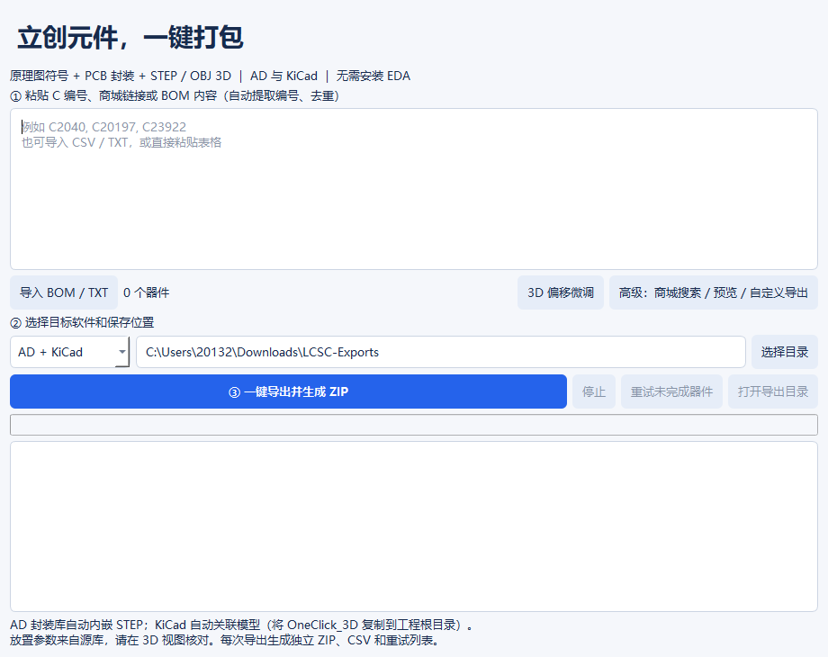

# 立创一键导出 · LCSC OneClick

**1.2 修复模型偏移：** 解析 STEP 实际几何，按立创源 3D 投影校正 X/Y 中心与底面高度；新增“3D 偏移微调”，可按 C 编号保存额外的毫米偏移。C225122 的实际偏移已纳入离线回归测试。

Windows 10/11 x64 便携工具：粘贴 C 编号 / 商城链接 / BOM，选择目标软件，一键导出 **原理图符号库、PCB 封装库和 STEP / OBJ 3D**，自动生成 ZIP。

基于 [Travelerrrrrr/LCSC3D](https://github.com/Travelerrrrrr/LCSC3D) 2.3.0 的 AGPL 开源衍生版本，复用原项目的网络、模型和 EDA 转换引擎。原作者和贡献者拥有原代码版权。原版说明见 [README.upstream.md](README.upstream.md)。



## 下载和使用

在本仓库 Releases 下载 `LCSC-OneClick-Windows-x64.zip`，解压后双击 `LCSC-OneClick.exe`。无需安装 Python、AD 或 KiCad。

1. 粘贴 `C2040 C20197`，或点击“导入 BOM / TXT”。支持 CSV、TSV、TXT，以及直接粘贴 Excel 表格；XLSX 请先另存为 CSV。
2. 选择 AD、KiCad、AD + KiCad 或仅 3D，选择保存目录。
3. 点击“一键导出并生成 ZIP”。完成后打开导出目录。

如需搜索商城、登录收藏、查看符号/封装/3D 预览和配置自定义库，点击“高级”。

## 新增的工作流

- 默认同时导出 AD 和 KiCad：不用分别切换、逐项勾选六种格式。
- 从混合 BOM 文本和含 C 编号的链接自动提取、去重，保持输入顺序。纯数字商品 ID 链接无法推导 C 编号。
- 每次导出创建唯一目录，不覆盖此前结果。
- 生成 ZIP、`results.csv`、`manifest.json`、`retry.txt` 和使用说明；失败保留已成功资源。
- “重试未完成器件”把缺失任一格式的器件带入新任务。新包只包含重试器件，完整结果仍在原包。
- 可取消任务；保留已完成文件和结果。正在请求的网络操作需要等待超时或返回后才停止。

## 导出内容

| 目标 | 输出 |
| --- | --- |
| Altium Designer | `OneClick.SchLib`、`OneClick.PcbLib` |
| KiCad 8+ | `OneClick.kicad_sym`、`OneClick.pretty/*.kicad_mod` |
| 3D | `OneClick_3D/*.step`、`*.obj`；仅3D模式按器件分目录 |
| 结果 | CSV、JSON 清单、可重新导入的重试 TXT、整个任务 ZIP |

KiCad 添加符号库和封装库时，库昵称均设为 `OneClick`。AD 直接打开两种库文件。

**1.1 新增：AD 封装库自动内嵌 STEP。** STEP 压缩写入 PcbLib 的 `Library/Models`，封装包含引用同一模型 GUID 的原生 3D Body；移动库文件无需携带外部 STEP。放置偏移、旋转和高度取自立创源库。KiCad 封装自动写入 STEP 引用，将 `OneClick_3D` 文件夹复制到你的 KiCad 工程根目录即可解析 `${KIPRJMOD}` 路径。

自动绑定在“一键导出”流程中执行；高级模式仍提供上游的自定义二维导出功能。

**本工具导出元件库，不是整板 PCB/原理图工程。** 官方没有 STEP、源模型放置数据不受支持、或多个器件共享二维封装但关联不同模型时，会保留二维资源并明确报告原因。不会猜测缺失的放置参数或选用冲突模型。生产前仍须在 3D 视图核对位置、旋转、高度；本次未在 Altium Designer 桌面软件中人工验收。

一键入口不启动上游自动更新。升级本衍生版本请从本仓库 Releases 下载。运行产生的设置、缓存、日志与临时文件使用上游 `%LOCALAPPDATA%/LCSC3D/` 目录。

## 从源码运行 / 构建

```powershell
python -m venv app/.venv
app/.venv/Scripts/python.exe -m pip install -r app/requirements-test.txt
app/.venv/Scripts/python.exe app/oneclick.py
powershell -ExecutionPolicy Bypass -File app/build.ps1
```

构建入口 `app/launcher.py` 默认启动一键界面。固定产物 `outputs/LCSC3D.exe` 兼容上游构建脚本，发行时复制为 `LCSC-OneClick.exe`。

验证记录见 [docs/ONECLICK-VALIDATION.md](docs/ONECLICK-VALIDATION.md)。源代码遵循 AGPL-3.0-or-later；第三方声明见 `app/licenses/`。软件许可证不替代元件资源自身的版权与使用条件。
