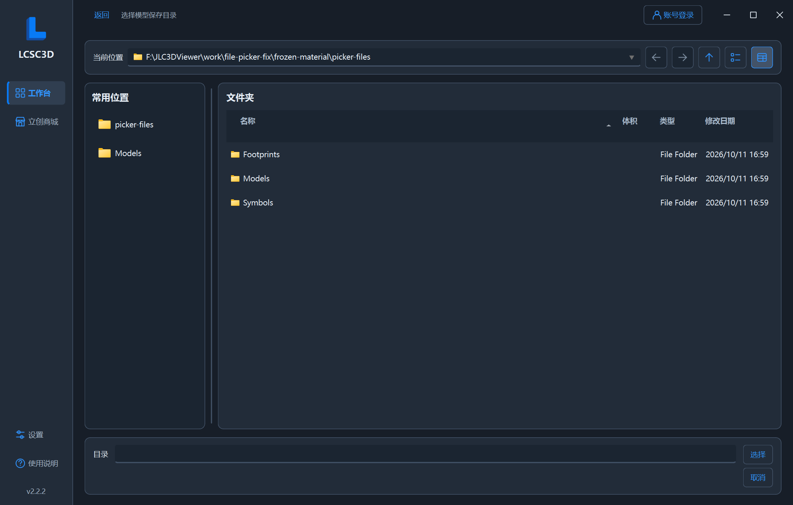

# LCSC3D 2.2.2 本地交付验证

验证日期：2026-10-11。Windows x64，使用仓库的 Python/Qt 构建环境。验证时指定独立的 `LOCALAPPDATA`，日志、诊断包及测试临时文件保存在 `work/v2.2.2/` 与 `work/file-picker-fix/`，未读取真实登录会话。

## 自动回归与构建

- `app/build.ps1` 最新运行 **456 项全量测试**，全部通过，覆盖原有下载、库转换、备份、日志、设置、主题、商城和更新逻辑，以及新增的文件选择页回归。
- 追加专项 **26 项测试**通过，包含自定义 3D/SchLib/PcbLib 目录与库名、单库/双库、中文及扩展名、重复追加保留原条目、自定义和默认独立器件目录、路径冲突、设置恢复及旧版导入勾选迁移。
- 配置页导入按钮验证空/非空列表、未勾选器件、当前未保存目标、重复引用跳过、无效库失败、处理期间防重入、错误后恢复按钮，以及工程原内容保留。
- 根据界面核对，将仅用于工程导出的配置改为按需展开后，再次通过上述 26 项专项回归，并重新构建最终 EXE。
- 最终 EXE 的 Windows 文件版本和产品版本均为 **2.2.2**，固定入口为 `outputs/LCSC3D.exe`。

## 最终 EXE 自检

- `--self-test-export`：**17 个完整窗口流程**全部通过，包括普通合并、已有单库/双库追加、工程配套库、自定义三个资源目录和两种库名、自定义独立器件目录、空/非空列表直接导入，以及共享封装复用。使用公开 CAD 固定样本与离线模型替身。
- 对实际导出文件使用独立读取器核对 **84 次库内容**和 **38 对符号/封装引用**，检查引脚、焊盘数量及配套名称；独立解析工程引用，确认自定义目录中的两份集中库被正确引用，逐器件库未重复加入工程。
- `--self-test-settings`：保存与恢复全部新增目录及库名通过；代理、主题、日志设置回归通过。日志打包、清除后继续记录以及运行时文件位置验证通过。
- `--self-test-material`：单窗口导航、明暗主题、中文/English、大字号与小窗口、窗口控制和官方符号/封装预览通过。
- `verify_app_data.py`：从独立 EXE 副本验证旧配置迁移和全新配置启动，退出码均为 0；设置、日志和运行时解压均在隔离的 `LOCALAPPDATA/LCSC3D/`，EXE 目录和运行工作目录保持清洁。
- 已查看最终程序的追加配置及直接导入结果截图，文件选择、库名、独立目录、按钮和状态提示可见，超出部分可滚动访问。

本次验证未操作 Altium Designer 的工程重载或元件放置，未重新执行真实商城账号登录或公开网络资源下载。原有相关证据保留在 [2.2.1 验证记录](验证记录.md)。

## 文件选择页图标与分区修复

- 复现右上角图标白块：Qt Material 默认工具按钮的左右各 12px 边框，挤占了 Qt 文件选择页固定尺寸按钮的图标区域。对文件选择页限定样式覆盖，调整按钮尺寸并使用可随主题、字号更新的矢量图标，明确禁用和当前视图状态。
- 用共享 Material 卡片承载路径工具栏、左侧常用位置、右侧文件列表和底部选择区域；中间分隔线可拖动，保留 Qt 文件模型、原有导航信号和扩展名筛选。目录选择隐藏文件类型行。
- **35 项相关测试**通过；图标回归直接检查按钮中央的实际像素，覆盖浅色、深色及接近白/黑的自定义主色，避免仅检查图标对象存在却仍渲染为空白。另验证前进/后退、上一级、侧栏导航、视图切换、文件/目录确认、取消、筛选、嵌套返回和大字号可访问性。
- 实际 EXE 的 `--self-test-material` 重新核对上述图标与分区，捕获浅色、深色、24px 英文目录页及库文件选择页，执行真实按钮和选中文件后的回调；`--self-test-export` 再次通过 17 个完整流程。
- 本节截图来自隔离测试目录与空白登录状态，没有使用用户提交截图中的账号或工程目录。完整日志与报告保存在 `work/file-picker-fix/`。

## 成品一致性

`scripts/verify_bundle.py` 核对最终 EXE 内 **44 个应用模块、33 个资源**与工作区一致，同时检查 Qt Material 模板和图标资源。源码 ZIP 按文件内容与工作区比较，并检查覆盖所有 Git 跟踪文件及本次新增文件。

`outputs/v2.2.2/` 与 `outputs/` 根目录同步提供 `LCSC3D.exe`、`LCSC3D.zip`、`使用说明.md`、`SHA256SUMS.txt` 和本验证说明，校验和对应 EXE 与源码包。构建、测试日志和 JSON 报告保留在已忽略的 `work/v2.2.2/`。

本次仅作本地 Git 提交，没有推送、打标签或发布 Release。

## 本地分支同步（2026-10-11）

- 以产品修复提交 `a74b033` 为基础，核对另外四个本地分支均位于其祖先 `fd22427`，没有分叉或独有提交，工作区干净且没有其他检出中的工作树。
- 补充本记录后，将 `main`、`codex/bug-fix`、`codex/functional-demo`、`codex/lcsc-favorites-demo` 和 `codex/qt-material-ui` 快进对齐到同一提交；继续使用 `codex/functional-demo`。
- 本次不修改应用源码，沿用已通过 456 项回归及实际 EXE 自检的成品；重新核对 EXE 内模块、资源与工作区一致，并同步包含本记录的源码包、验证记录和校验和。
- 分支同步使用原提交校验及原子引用更新，保留已有提交；远程跟踪引用和标签保持原值。本地核对材料保存在 `work/local-branch-sync-2.2.2/`。
