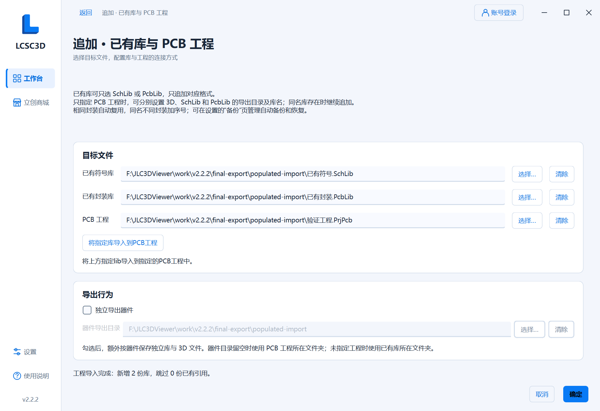
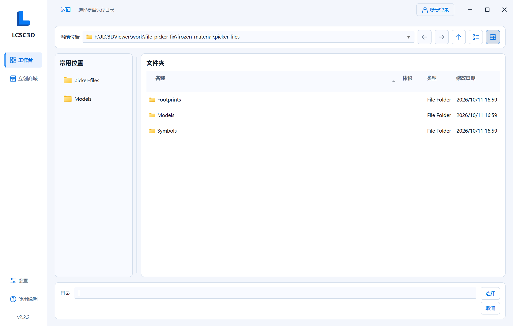

# LCSC3D 2.2.2

本地开发版本，2026-10-11。未推送、打标签或发布 GitHub Release。

## 追加导出目录与库名

- 仅指定 PCB 工程时，可分别设置 3D、SchLib、PcbLib 的输出目录，并单独修改 SchLib、PcbLib 库名。目录和名称留空时，库使用工程目录和工程名称。
- 自定义库名支持中文和对应扩展名，拒绝路径、Windows 禁用字符及保留设备名；同名库已存在时继续追加，原内容保留。
- 勾选 **独立导出器件** 后可选择器件导出目录。留空时优先使用 PCB 工程所在文件夹，无工程时使用已有库所在文件夹。集中库位置保持由库目标决定。
- 3D 目录留空时沿用库名 `_3D` 或逐器件目录；指定后使用所选目录，独立导出时在其下按器件分文件夹。
- 新设置支持保存与恢复，普通导出和合并模式不使用追加模式保存的路径。

## 直接导入指定库

原 **将已选已有库导入PCB工程** 勾选项改为追加配置页目标文件下方的 **将指定库导入到PCB工程** 按钮。功能描述：**将上方指定lib导入到指定的PCB工程中。**

仅同时指定至少一份 lib 和 PCB 工程时启用。按钮直接使用当前填写的目标，无须先确定配置或下载器件，下载列表为空、有器件或全部未勾选均可操作。重复引用跳过，成功或失败结果显示在配置页，处理期间防止重复点击。

主页 **开始下载** 始终用于下载器件。已有库的工程导入由该按钮执行，旧版保存的勾选不再触发自动导入。仅指定工程时，下载生成的配套集中库仍自动加入工程。

## 本地交付

本版同时修复文件选择页右上角工具图标显示为白块的问题。导航按钮使用适配主题和字号的矢量图标，左侧“常用位置”与右侧文件列表采用独立 Material 卡片，并保留可拖动分隔线；路径栏与底部选择区域也做了统一分区。

最新程序为 `outputs/LCSC3D.exe`，本版同步存放在 `outputs/v2.2.2/`。源码包、使用说明和 SHA-256 校验和随程序同步生成。配置、日志、备份及运行临时文件继续保存在 `%LOCALAPPDATA%/LCSC3D/`。

验证范围与结果见 [2.2.2 验证记录](../2.2.2验证记录.md)，操作细节见 [使用说明](../../app/README.md#追加已有库与-pcb-工程)。
